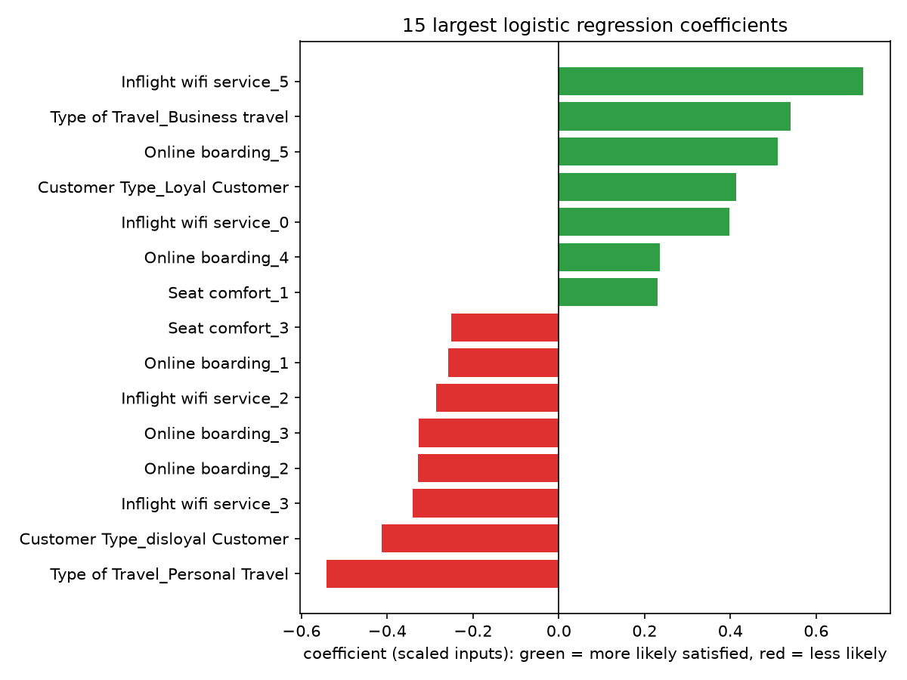
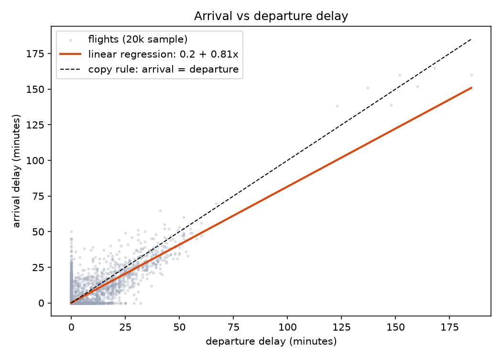
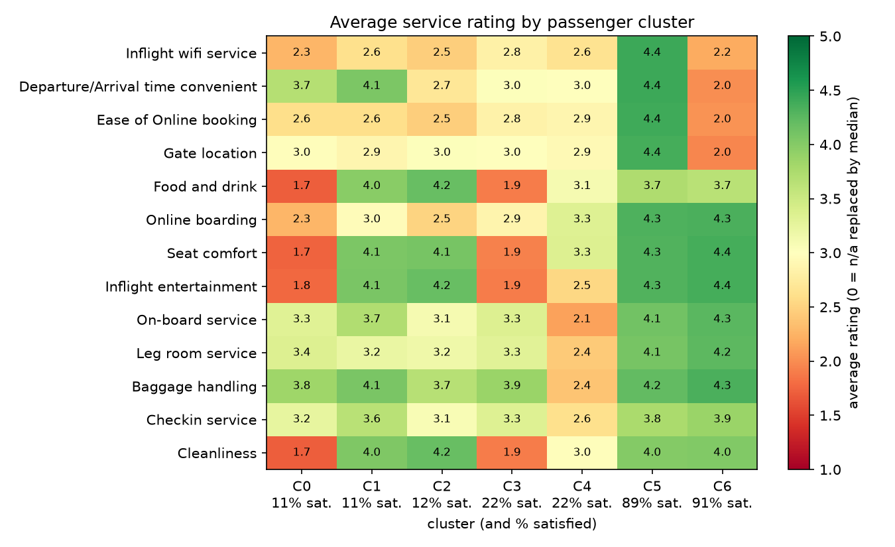
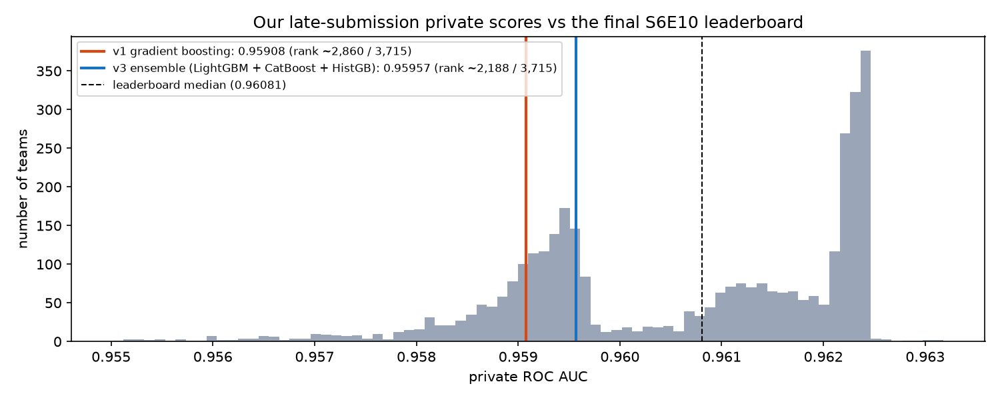

# CS4650 Capstone Report: Predicting Airline Satisfaction

## 1. Team

| Name | Contribution |
|---|---|
| Khine Zar Hein | Team lead. Shared cleaning code, MapReduce job, linear and logistic regression, gradient boosting, LightGBM/CatBoost ensemble, K-means clustering, Kaggle submissions, report |
| Devin Davis | Reviewed the linear regression section (4.3); section 6 paragraph. **TODO: confirm** |
| Wesley Trinh | Reviewed the logistic regression section (4.2); section 6 paragraph. **TODO: confirm** |
| Jacqueline Ninh | Reviewed and edited the report; section 6 paragraph. **TODO: confirm** |

Code and notebooks: https://github.com/Khine12/CS-4650-Capstone-Project

## 2. Dataset and competition

We chose the Kaggle competition **Playground Series Season 6, Episode 10: Predicting Airline Satisfaction**
(https://www.kaggle.com/competitions/playground-series-s6e10). The data is synthetic, generated from a real
airline passenger survey. Each row is one passenger; the task is to predict the **probability** that the
passenger was satisfied. Submissions are scored by **ROC AUC** (1.0 = perfect ranking, 0.5 = random).

- 699,635 training rows and 299,844 test rows; 21 features plus an `id` and the target
- 44.4% of training passengers are satisfied
- Features: gender, customer type (loyal / disloyal), age, type of travel (business / personal), class (Business / Eco / Eco Plus), flight distance, departure and arrival delay, and 13 service ratings on a 0–5 scale
- The competition ran Sep 30 – Oct 31, 2026, with 3,734 teams and 44,249 submissions. It had closed when we started, so we submitted as **Late Submissions**, which Kaggle still scores on the public and private test sets but does not place on the leaderboard

## 3. Approach and data cleaning

### 3.1 Cleaning
All models use one shared module (`src/clean.py`) so their scores can be compared fairly.

| Problem found | What we did | Why |
|---|---|---|
| 292 missing `Arrival Delay in Minutes` (130 in test); nothing else missing | Filled with the departure delay of the same flight | Arrival and departure delay correlate at 0.84; linear regression (4.3) confirms the rule is reasonable |
| Delays and flight distance are heavily right-skewed | `log1p` transform | Keeps a few huge delays from dominating linear models |
| 4 text columns | One-hot encoding | Models need numbers |
| A rating of **0 means "not applicable"**, not "terrible" (12 of the 13 ratings use 0) | For linear models, ratings are one-hot encoded so 0 is its own category | Treating 0 as the lowest score misleads a linear model (see 4.1: AUC 0.921 → 0.948) |
| No duplicate rows | Nothing needed | |

### 3.2 Validation
Every model is scored on the **same** 80/20 stratified split of the training data (`make_split`, `random_state=42`).
This let us compare ideas without spending Kaggle submissions. It proved reliable: our validation AUC matched the
Kaggle public score within 0.00003 (v1) and 0.00017 (v3).

### 3.3 MapReduce
`src/mr_satisfaction_rate.py` (mrjob) computes the satisfaction rate for each Class × Type of Travel group over all
699,635 rows. The mapper emits `[satisfied, 1]` per passenger, and the combiner and reducer add these up as
**[sum, count]**. Emitting partial averages instead would give wrong answers once the combiner merges groups of
different sizes.

| Class | Type of travel | Passengers | Satisfied |
|---|---|---|---|
| Business | Business travel | 338,272 | 73.3% |
| Eco Plus | Business travel | 17,557 | 34.6% |
| Eco | Business travel | 141,612 | 26.0% |
| Business | Personal travel | 3,940 | 11.2% |
| Eco | Personal travel | 185,792 | 9.7% |
| Eco Plus | Personal travel | 12,462 | 9.5% |

Type of travel matters even more than class: personal travellers are rarely satisfied, even in Business class.

### 3.4 Modelling steps
1. Baselines: logistic regression and gradient boosting (`notebooks/00_baseline.ipynb`)
2. Try to improve gradient boosting with new features and tuning (`01_khine_features_boosting.ipynb`)
3. Try stronger models (LightGBM, CatBoost) and average them (`02_khine_catboost_lightgbm.ipynb`)
4. Clustering to describe passenger groups (`03_khine_clustering.ipynb`)
5. Linear regression on delays (`04_linear_regression.ipynb`) and logistic regression tuning (`05_logistic_regression.ipynb`)

## 4. Results and visualizations

### 4.1 Model comparison

| Model | Validation AUC | Kaggle public | Kaggle private |
|---|---|---|---|
| Logistic regression, ratings as numbers | 0.92064 | | |
| Logistic regression, ratings one-hot | 0.94767 | | |
| Gradient boosting (HistGradientBoosting), **v1** | 0.95758 | 0.95761 | 0.95908 |
| Gradient boosting + extra features + tuning | 0.95745 | | |
| CatBoost | 0.95755 | | |
| LightGBM | 0.95819 | | |
| **v3 ensemble**: 0.7 LightGBM + 0.2 CatBoost + 0.1 gradient boosting | **0.95824** | **0.95841** | **0.95957** |
| Logistic regression, tuned (best: L2, C = 0.1) | 0.94767 | | |

Tree models beat logistic regression by about 0.01 AUC: they find interactions such as "business traveller **and**
Business class" on their own. Among tree models, gains were small; the ensemble averages the **ranks** of the three
models' predictions, because AUC only depends on the order of the predictions.

**Confusion matrix** (v1 gradient boosting, validation split, threshold 0.5):

| | Predicted not satisfied | Predicted satisfied |
|---|---|---|
| **Actually not satisfied** | 73,464 | 4,395 |
| **Actually satisfied** | 6,144 | 55,924 |

Accuracy 92.5%, precision 92.7%, recall 90.1%. The model misses more satisfied passengers (6,144) than it wrongly
flags unsatisfied ones (4,395).

**Strongest features** (permutation importance, `figures/feature_importance_v2.png`): type of travel, inflight wifi,
an average of the digital-service ratings, customer type and online boarding. Online boarding is also the single
rating most correlated with satisfaction (0.56).

### 4.2 Logistic regression tuning and coefficients
Starting from the one-hot logistic regression (90 scaled columns), we tried different regularization strengths C
(smaller C = simpler model) with L2 and L1 penalties (`notebooks/05_logistic_regression.ipynb`):

| Penalty | C | Validation AUC | Non-zero coefficients |
|---|---|---|---|
| L2 | 0.01 | 0.94766 | 90 |
| L2 | 0.1 | 0.94767 | 90 |
| L2 | 1 | 0.94767 | 90 |
| L2 | 10 | 0.94767 | 90 |
| L1 | 0.01 | 0.94764 | 76 |
| L1 | 0.1 | 0.94767 | 79 |
| L1 | 1 | 0.94767 | 90 |

Tuning made no real difference (all within 0.00003). With 560,000 training rows and only 90 columns the model is
not overfitting, so regularization has little to fix. L1 at C = 0.01 dropped 14 columns while losing only 0.00003
AUC, so those columns carry almost no information. The limit of this model is that it is linear, not its settings.

The largest coefficients agree with the other analyses. A 5-star wifi or online-boarding rating, business travel
and being a loyal customer push the prediction toward *satisfied*, while personal travel, disloyal customers and
middling (2–3 star) wifi and online-boarding ratings push it toward *unsatisfied*. A wifi rating of 0
("not applicable") also leans toward satisfied, which supports treating 0 as its own category rather than as the
worst score. Because every category of a rating has its own column, single coefficients should be compared within
the same rating (5 stars vs 3 stars), not read on their own.

### 4.3 Linear regression
To check the cleaning rule in 3.1, we fit a linear regression that predicts arrival delay from departure delay
(`notebooks/04_linear_regression.ipynb`), using the 699,343 flights where both are known, trained on 80% and tested
on the other 20%:

**arrival delay ≈ 0.18 + 0.814 × departure delay** (minutes)

| Rule | R² | RMSE (min) | MAE (min) |
|---|---|---|---|
| Linear regression | 0.682 | 3.09 | 0.95 |
| Copy the departure delay (our cleaning rule) | 0.639 | 3.29 | 0.88 |

The slope below 1 means flights make up about a fifth of a departure delay in the air. The fitted line explains
more of the variance (R² 0.68 vs 0.64) and has the lower RMSE, but the copy rule has the lower typical error (MAE),
because 91% of flights leave on time and copying a 0 is then exactly right. Both rules are reasonable. Since they
only fill 292 of 699,635 rows (0.04%), the choice cannot change the model scores, so we kept the simpler copy rule.

### 4.4 Clustering
We ran K-means on 19 scaled columns: the 13 ratings (0 replaced by the column median), age, flight distance, total
delay, class, type of travel and loyalty. **Satisfaction was not used to build the clusters.** We tried k = 2 to 8
and scored each with the silhouette coefficient on a 20,000-row sample.

We chose **k = 7** (silhouette 0.160, the best for k ≥ 3). A silhouette this low means the groups overlap, so we
read them as passenger *types* rather than sharp segments.

| Cluster | Share | Satisfied | Who they are |
|---|---|---|---|
| C6 | 19.9% | 91% | Loyal business travellers, 95% in Business class; rate the on-board experience high but wifi, booking, timing and gate low |
| C5 | 18.9% | 89% | Business travellers, 87% in Business class; rate everything high |
| C4 | 15.5% | 22% | Loyal, older (~45) travellers; low on-board service, leg room and baggage ratings |
| C3 | 8.5% | 22% | Disloyal young (~28) business travellers; very low seat, food, entertainment, cleanliness |
| C2 | 8.1% | 12% | Disloyal young business travellers; good on-board ratings, weak digital ratings |
| C1 | 15.9% | 11% | Loyal personal travellers, almost all in Economy; good ratings but still unsatisfied |
| C0 | 13.1% | 11% | Loyal, younger (~33), mostly personal travel; very low seat, food, entertainment, cleanliness |

Even without the target, K-means separates the passengers into two worlds: about 39% are satisfied business
travellers in Business class (C5, C6), while every other group is 11–22% satisfied. Cluster C6 shows that a good
on-board experience outweighs poor wifi or booking ratings, and C1 shows that personal travellers in Economy stay
unsatisfied even when they rate the service well. This agrees with the MapReduce table and the feature importance.

### 4.5 How we visualized the results
- Model table and confusion matrix (4.1) to compare models and show the kinds of errors
- Feature importance bar chart (4.1) and logistic regression coefficient chart (4.2) for which inputs matter, and in which direction
- Scatter plot with the fitted line (4.3) to compare the regression with our cleaning rule
- Silhouette/elbow chart, ratings heatmap and satisfaction bars (4.4) to describe the clusters
- Histogram of the leaderboard with our scores marked (5) to show where we stand

## 5. Comparison with other submissions

Kaggle scores late submissions but does not rank them, so we compared our **private** scores with the final private
leaderboard (downloaded 2026-11-26; 3,715 teams with a valid score; best 0.96318, median 0.96081).

| Submission | Public | Private | Would rank |
|---|---|---|---|
| v1 gradient boosting | 0.95761 | 0.95908 | ~2,860 / 3,715 |
| v3 ensemble | 0.95841 | 0.95957 | **~2,190 / 3,715** (top 59%) |

The ensemble moved us up about 670 places. The leaderboard has two humps: a large group of teams around 0.959,
where we are, and a tall spike at 0.962–0.9625. Almost no team scored in between, which suggests most top teams used
a technique we did not, for example adding the original (non-synthetic) survey data to training.

Screenshots of our Kaggle submissions page: `figures/kaggle_submissions_2026-11-27.png` and
`figures/kaggle_submissions_v3_2026-11-27.png`.

## 6. What worked well, what did not

**Khine.** What worked: treating the "0 = not applicable" ratings as categories (logistic AUC 0.921 → 0.948); one
fixed validation split, which predicted the Kaggle public score within 0.0002; and switching to a different model
(LightGBM) rather than tuning the old one. LightGBM alone gained +0.00061 and the three-model ensemble +0.00066,
which moved us about 670 places. What did not: hand-made features (rating averages, counts of 0 ratings, total delay)
and tuning gradient boosting made validation AUC slightly *worse* (0.95745 vs 0.95758), because tree models already
find this information. Blending with logistic regression added nothing, and CatBoost alone only tied the baseline
while taking about 25 minutes to train. Tuning logistic regression (C, L1 vs L2) also changed nothing, which showed
that its limit is being linear, not its settings. Clustering gave clear passenger types but overlapping groups
(silhouette 0.16), and linear regression confirmed that our simple rule for missing arrival delays was reasonable.

**Devin.** **TODO**

**Wesley.** **TODO**

**Jacqueline.** **TODO**

## AI assistance

The code (cleaning module, MapReduce job, notebooks 00–05) and the first draft of this report were written with AI
assistance (Claude). Khine directed the work, ran every notebook, checked the results and made the Kaggle
submissions. **TODO:** each teammate adds a line for any AI help on their part. (Check the course policy.)
